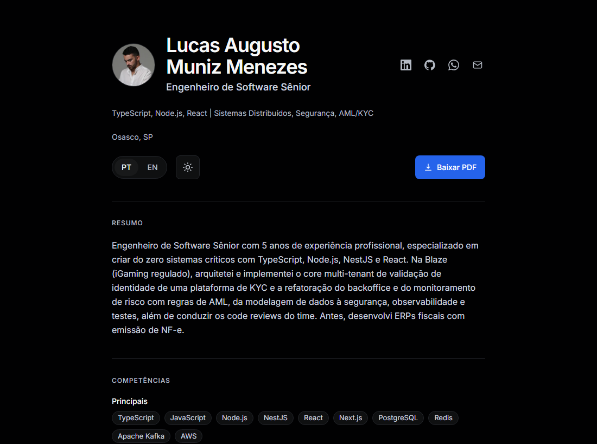

# menelucas.com

Currículo em **HTML semântico, bilíngue (PT/EN)**, gerado a partir de **um único arquivo de dados** ([`content/resume.json`](content/resume.json)).
React + TypeScript renderizam o HTML **em tempo de build**: o que vai para a AWS é só HTML, um CSS embutido e imagens. Sem servidor, sem EC2, sem JavaScript de framework no navegador.



## Stack

- **React 19 + TypeScript estrito** (`renderToStaticMarkup` no build, sem hidratação)
- **Tailwind CSS v3** compilado (tokens do design system do Linear, acento azul `#3b82f6`)
- **Zod** valida `resume.json` e `ui.json` no build (idioma faltando = build quebrado)
- **Vitest** (dados/schema/HTML) e **Playwright + axe** (smoke, PT/EN, links, a11y, viewports)
- **GitHub Actions** → S3 + CloudFront via **OIDC** (sem chaves no repositório)

## Arquitetura

```
content/resume.json ─┐
content/ui.json ─────┤  Zod        React (SSR no build)        dist/
                     └─► validação ─► Page → HTML estático ─►  index.html      (PT, /)
public/ (PDFs, imagens)                                        en/index.html   (EN, /en/)
src/styles (Tailwind) ── compilado e embutido no <style> ──►   assets/, *.pdf, imagens
                                                                 │
                                       GitHub Actions (OIDC) ────┤ aws s3 sync
                                                                 ▼
                                          S3 privado ◄─ OAC ─ CloudFront ─ menelucas.com
```

Um script inline de poucos bytes (`src/seo/redirect-script.ts`) lembra a escolha do botão PT|EN (`localStorage`, com `try/catch`) e, **só na primeira visita à página PT**, redireciona navegadores que não sejam `pt*` para `/en/`.

## Rodando localmente

Requer Node 20+.

```bash
npm install
npm run dev        # build + servidor em http://localhost:4321, com rebuild ao salvar
npm run check      # lint, typecheck, testes unitários e build
npm run test:e2e   # Playwright + axe (instale o navegador antes: npx playwright install chromium)
```

## Editando o currículo

Edite **apenas** [`content/resume.json`](content/resume.json) (e, para textos da interface, [`content/ui.json`](content/ui.json)).
O formato segue o [JSON Resume](https://jsonresume.org/schema), com todo texto visível como `{ "pt": "...", "en": "..." }`.
O schema fica em [`src/schema/resume.ts`](src/schema/resume.ts); campos desconhecidos, datas fora de `AAAA-MM` ou idioma faltando falham o build.

**Projetos:** a seção `projects` é opcional (campos `name`, `roles`, `startDate`, `endDate?`, `description`, `highlights`, `url?`; sem `endDate` mostra "atual"/"present"). Sem o campo, ou com a lista vazia, a seção não aparece: para tirá-la basta remover o item do `resume.json`. Projetos não entram no JSON-LD.

**Aba Projetos:** se algum projeto tiver `gallery`, o site ganha as abas "Currículo | Projetos" e as páginas `/projetos/` e `/en/projects/` (detalhes em `detailSections`, nota em `notice`, telas em `gallery`, com imagens em `public/projetos/`). Sem projeto com galeria, a aba e as páginas não são geradas. A página de projetos não tem JSON-LD.

Extensões ao JSON Resume: `work[].sections[]` (subtítulos de projeto), `skills[].keywords` por idioma e `meta.pdf` (PDF de cada idioma).
Os PDFs (`public/cv.pdf`, `public/cv-en.pdf`) são mantidos como estão e usados só para download.

Para gerar de novo avatar e favicons: `npm run assets -- <foto> --bust=… --face=…` (ver `scripts/assets.ts`).
Para regerar os banners de compartilhamento (um por idioma, `public/banner-pt.jpg` e `banner-en.jpg`): `npm run banner -- <foto.jpg>`.

## Deploy

Push na `main` → CI (lint, tipos, testes, e2e) → build → `aws s3 sync` → invalidação do CloudFront.
Também dá para rodar manualmente (*Actions → Deploy → Run workflow*) com destino **staging** (`/staging/` no mesmo bucket, com `BASE_PATH=/staging/`) antes de ir para produção.

A infraestrutura já existe na conta AWS; o que falta configurar uma vez está em [`infra/README.md`](infra/README.md):
CloudFront Function (`/en/` → `/en/index.html`), role OIDC de escopo mínimo e a variável `AWS_ROLE_ARN` no GitHub.

## Revisão do checklist de interface (Vercel, `AGENTS.md`)

| Item | Situação |
| --- | --- |
| Teclado, foco visível, sem `outline: none` | ✅ `:focus-visible` com anel azul; skip link como primeiro foco (e2e) |
| Alvos ≥44px no mobile; `touch-action: manipulation`; tap highlight | ✅ links do cabeçalho ≥44px de largura (toggle 36px de altura no mobile, com área de 44px) |
| Zoom do navegador não desabilitado | ✅ viewport sem `user-scalable`/`maximum-scale` |
| `prefers-reduced-motion` | ✅ transições/animações reduzidas |
| Sem `transition: all`; só propriedades listadas | ✅ `transition-colors` |
| Safe areas, sem scroll horizontal, mobile/laptop/ultra-wide | ✅ `env(safe-area-inset-*)`; e2e em 375/768/1440/2560px |
| `<title>` por idioma, h1–h6 hierárquicos, `scroll-margin-top`, skip link | ✅ |
| `tabular-nums` em números/datas | ✅ períodos das experiências |
| Datas via `Intl.DateTimeFormat` | ✅ `formatYearMonth` |
| `translate="no"` em nomes próprios | ✅ nome e empresas |
| Ícones com `aria-label`; decorativos `aria-hidden`; nome acessível contém o texto visível | ✅ (o axe pegou o toggle PT/EN e foi corrigido) |
| `text-wrap: balance`/`pretty` | ✅ |
| Preload da fonte crítica com `font-display: swap`; imagens com dimensões | ✅ Inter própria (latin) e avatar 80×80 |
| `color-scheme: dark`, `theme-color` igual ao fundo | ✅ `#010102` |
| Contraste (APCA) | ✅ texto principal Lc 81–103, secundário Lc 64–65, botão Lc 80 |
| Formulários, modais, drag, hidratação, virtualização | n/a (página sem esses elementos) |

Pendente de verificação manual: Lighthouse ≥95 e prévia no WhatsApp/LinkedIn.

## Roadmap

- **Servidor MCP** para editar o currículo por conversa (`add_experience`, `update_skills`, `translate`, `publish`), usando o mesmo schema Zod.
- **Temas modulares** por design tokens / `DESIGN.md` (os tokens já estão isolados em `tailwind.config.ts`).
- **Backoffice web** sobre o `resume.json`.
- **CLI de deploy** com domínio próprio (`npx … deploy --domain`).
- Gerar o PDF a partir do próprio HTML com Playwright (`page.pdf()`).

## Licença

Código sob MIT. O conteúdo do currículo (`content/`, `public/`) é de Lucas Augusto Muniz Menezes e não é livre para reuso.
